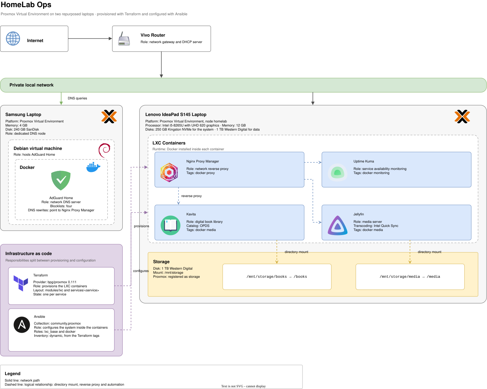

> [!NOTE]
> This repository contains the **architecture documentation** of the home lab: a diagram and a
> written description of how the environment is built.
>
> Everything needed to build and operate the environment is kept in a separate **private
> repository**:
>
> - **Terraform** and **Ansible** code and scripts;
> - State files and inventories;
> - Credentials (if any), host-specific values and other personal information.
>
> Both repositories are updated together whenever the architecture changes.

# HomeLab Documentation

<p align="justify">
    
    
    
    
    
</p>



## Contents

- [HomeLab Documentation](#homelab-documentation)
  - [Contents](#contents)
  - [Overview](#overview)
  - [The environment](#the-environment)
    - [Network](#network)
    - [Nodes](#nodes)
    - [DNS node](#dns-node)
    - [Main node](#main-node)
    - [Services](#services)
    - [Storage](#storage)
    - [How a request flows](#how-a-request-flows)
  - [Infrastructure as code](#infrastructure-as-code)
    - [Terraform](#terraform)
    - [Ansible](#ansible)
    - [The handoff](#the-handoff)
  - [Known limitations](#known-limitations)
  - [Roadmap](#roadmap)

## Overview

This home lab runs on **Proxmox Virtual Environment**, with its configuration spread across a
**hypervisor**, a set of **containers**, a **DNS server**, a **reverse proxy** and two
**automation tools**. This documentation brings those pieces together in one place and answers
three questions:

- **What is running**, and on which machine.
- **How a request reaches a service**, from the router down to the container.
- **Which tool owns which responsibility**, and where the boundary between them sits.

The diagram is the **reference artifact**. The text below describes the same environment in
prose and uses the same terminology, so a name that appears in one appears in the other. In
the diagram, a **solid line** is a **network path** and a **dashed line** is a **logical
relationship**, such as a directory mount, a reverse proxy route, or an automation step.

## The environment

### Network

A single **private local network** sits behind the **ISP router**, which acts as the network
gateway and `DHCP` server. Everything in the lab is on that network. **Nothing is exposed to
the internet.**

### Nodes

Two repurposed laptops run **Proxmox Virtual Environment**. They are **not a cluster**: each one
is an **independent node** with a distinct role.

| | DNS node | Main node |
|-|----------|-----------|
| **Laptop** | Samsung | Lenovo IdeaPad S145 |
| **CPU** | — | `Intel i5-8265U` |
| **Graphics** | — | `Intel UHD 620` |
| **Memory** | `4 GB` | `12 GB` |
| **System disk** | `240 GB` SanDisk | `250 GB` Kingston NVMe |
| **Data disk** | — | `1 TB` Western Digital |
| **Role** | DNS for the whole network | Every other service |
| **Guests** | One Debian VM | One LXC container per service |

### DNS node

The **Samsung** laptop is dedicated to **DNS** and runs nothing else. Inside it, a **Debian**
virtual machine hosts **AdGuard Home** in a **Docker** container. AdGuard Home is the DNS
server for the whole network: it resolves every query, applies **four blocklists**, and holds
the **DNS rewrites** that point local names to the **reverse proxy**.

The layering is worth reading literally in the diagram: a **physical laptop**, running a
**hypervisor**, running a **virtual machine**, running **Docker**, running **one service**. The only
reason this node exists separately is so that **DNS does not depend on the machine that
hosts everything else**.

### Main node

The **Lenovo IdeaPad S145** hosts every service other than DNS, inside **LXC containers**. Each
container has **Docker** installed, so the pattern is **one container per service**, with the
service itself running as a container inside it.

### Services

| Service | Role | Notes |
|---------|------|-------|
| **Nginx Proxy Manager** | Network reverse proxy | **Entry point** for the other services. The DNS rewrites in **AdGuard Home** point here. |
| **Uptime Kuma** | Service availability monitoring | Watches the other services. |
| **Kavita** | Digital book library | Exposes an `OPDS` catalog, so external readers can browse the library. |
| **Jellyfin** | Media server | Streams the library over the network. The `UHD 620` graphics can provide **Intel Quick Sync** for hardware transcoding once the device is passed into the container. |

Every container carries **Terraform tags** that describe what it is: `docker` on all of them,
plus `proxy`, `monitoring` or `media` depending on the service. Those tags are not
decoration, they are **the mechanism that connects the two automation tools**. See
[Infrastructure as code](#infrastructure-as-code) below.

### Storage

The `1 TB` Western Digital disk is mounted at `/mnt/storage` and registered in Proxmox as a
storage named `storage`.

Two directories on that disk are **bind mounted** into the containers that need them:

```text
/mnt/storage/books  →  /books    (Kavita)
/mnt/storage/media  →  /media    (Jellyfin)
```

The **data lives on the host**, not inside the containers. A container can be **destroyed and
recreated** without touching the library.

### How a request flows

1. A device asks **AdGuard Home** to resolve a local name.
2. AdGuard Home answers from its **DNS rewrites**, which point to **Nginx Proxy Manager**.
3. The device reaches Nginx Proxy Manager, which **proxies the request** to the container
   running the service.
4. The service reads its data from the directory **bind mounted** from `/mnt/storage`.

This is the intended path. See [Known limitations](#known-limitations) for the cases where a
device takes a different route.

## Infrastructure as code

The environment is **not configured by hand**. Two tools build it, with the responsibilities
split along a clear line: **Terraform provisions, Ansible configures.**

### Terraform

**Terraform** creates the **LXC containers** on Proxmox, using the [`bpg/proxmox`](https://registry.terraform.io/providers/bpg/proxmox/latest/docs) provider. Its
layout has two levels:

- `modules/lxc` is a single **reusable module** that describes what a container is.
- `services/<service>` is **one root module per service**, composing that module with the
  values of that service.

Each service keeps **its own state**. A service can be **planned, applied or destroyed on its
own**, without touching the others. That is the reason for the **per-service split** rather than
one root module iterating over a list.

Containers that hold **state worth protecting** carry a `protection` flag, which blocks
deletion at the **Proxmox level** rather than relying on the automation to be careful.

### Ansible

**Ansible** configures the system inside the containers. Three roles run in sequence:

- `update-os` brings the **operating system** up to date.
- `base-packages` installs the **shared tooling** every container gets.
- `docker-install` sets up the **container runtime** from the official repository.

Ansible never connects to the containers directly. The `community.proxmox` collection provides
a **connection plugin** that runs `pct exec` over `SSH` on the hypervisor, reaching inside each
container from the host.

The consequence is that **no container needs an SSH server**, a key pair or a reachable address
to be configured. The only account that exists for automation lives on the **hypervisor**, and
its `sudo` rights are restricted to a **single command**.

### The handoff

The two tools are **not chained by a generated file**. Terraform applies **tags** to each
container, and Ansible reads those tags from the **Proxmox API** as a **dynamic inventory**,
also through the `community.proxmox` collection. A container tagged `docker` lands in the
group that receives the `docker-install` role, and the grouping follows from the
provisioning itself.

This is why the tags appear on every service in the diagram: they are **the contract between
the two halves of the automation**.

## Known limitations

**DNS reaches devices inconsistently over IPv6.** The ISP router advertises **itself** as the
`DNS` server through `IPv6` **Router Advertisements**, a channel its firmware does not expose
for configuration. Devices that prefer `IPv6` bypass **AdGuard Home** entirely, which makes
both the **blocklists** and the **local name resolution** unreliable across the network.

The services are always reachable by address, so this affects **convenience**, not
availability. Fixing it properly requires a router the lab controls, which is why **remote
access** and **network control** sit together on the roadmap.

## Roadmap

Planned changes, roughly in order of priority. When one is done, it moves into the sections
above and into the diagram.

- [ ] **Backups**: scheduled backups of the containers and of `/mnt/storage`. Nothing is backed
  up today, so a disk failure would take the whole environment with it.
- [ ] **DNS redundancy**: a second **AdGuard Home** instance, kept in sync with the first, so
  name resolution survives the DNS node going down.
- [ ] **Hardware transcoding**: pass the integrated graphics device into the **Jellyfin**
  container so transcoding runs on the `UHD 620` instead of the `CPU`.
- [ ] **Remote access**: reach the services from outside the house through a **VPN**, without
  exposing anything to the internet.
